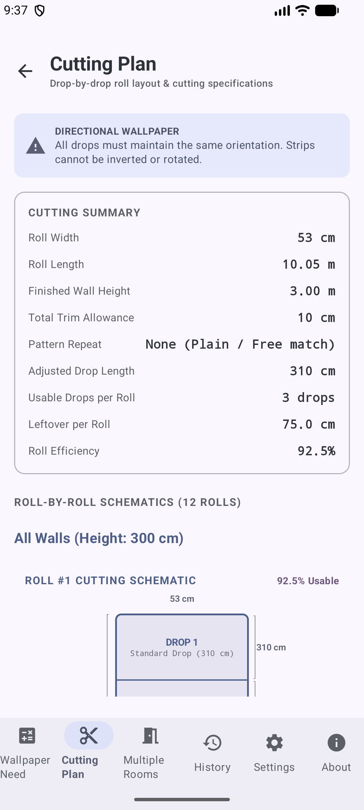
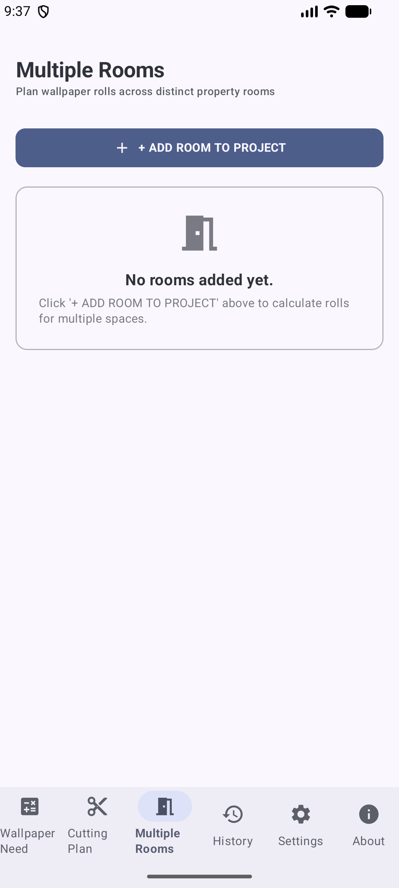
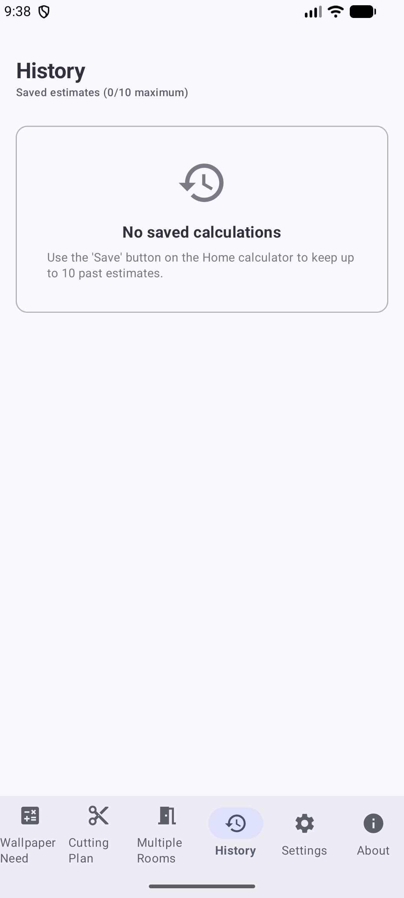
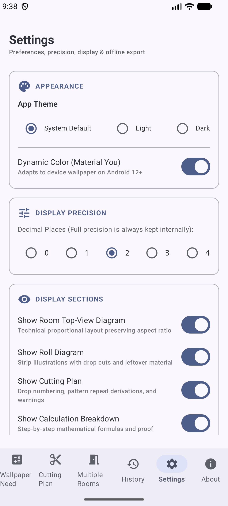
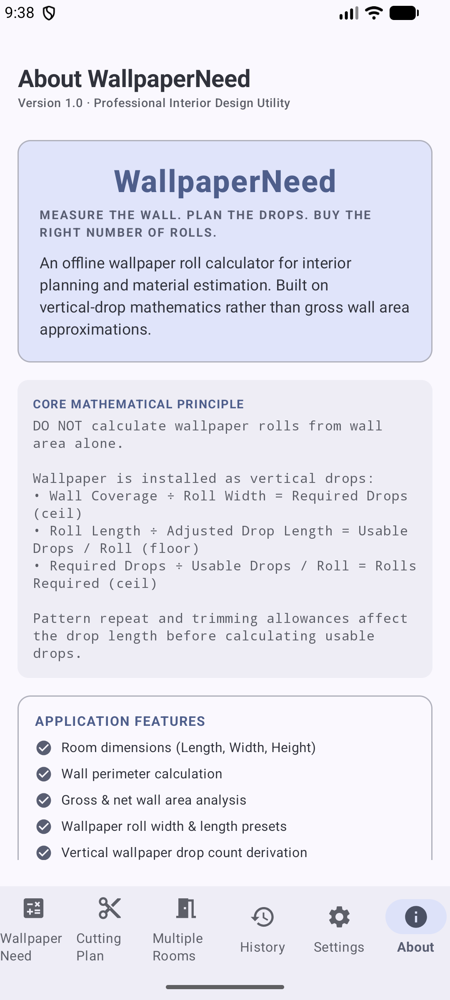

# WallpaperNeed 🖼️📏

**WallpaperNeed** is a professional, offline-first Android application designed for interior designers, decorators, and DIY enthusiasts to calculate exact wallpaper roll requirements, waste percentages, and strip cutting plans. 

Unlike generic calculators that rely on simple gross wall surface area approximations, **WallpaperNeed** uses precise **vertical-drop mathematics** accounting for roll width, cut length, top/bottom trimming allowances, pattern repeat matching (Free, Straight, Half-Drop), and door/window openings.

---

## 📱 Screenshots

| Main Calculator | Cutting Plan Visualizer | Multi-Room Planner |
|:---:|:---:|:---:|
|  |  |  |

| History Log | Settings & Customization | About & Formulas |
|:---:|:---:|:---:|
|  |  |  |

---

## ✨ Key Features

- 📐 **Drop-Based Mathematics**: Calculates exact vertical strip counts, usable drops per roll, trim waste, and required rolls.
- 🎨 **Pattern Match Compensation**:
  - **Free Match (0 cm)**: No pattern alignment required.
  - **Straight Match**: Full repeat length added per strip for pattern alignment.
  - **Half Drop Match**: Staggered alignment calculation to ensure pattern continuity across strips.
- 🖼️ **Visual Diagrams**:
  - **Roll Cutting Layout**: Custom Compose Canvas diagram illustrating how each roll is cut into strips and remaining off-cuts.
  - **Room Elevation Diagram**: Visual representation of wall drops and openings.
- 🚪 **Doors & Windows Openings**: Option to subtract door and window openings or reuse header/footer off-cuts.
- 🏠 **Multi-Room Project Aggregation**: Combine calculations across multiple walls and rooms for total project rolls and estimated cost.
- 📜 **History & Product Profiles**: Save calculations to local history, load preset wallpaper profiles, and re-examine past projects.
- 📏 **Multi-Unit Support**: Seamlessly switch between **Centimeters (cm)**, **Meters (m)**, **Millimeters (mm)**, **Feet (ft)**, and **Inches (in)**.
- 🌙 **Material 3 & Dark Theme**: Built with Jetpack Compose Material 3 supporting Light Theme, Dark Theme, and System Dynamic Colors.

---

## 🧮 Core Mathematical Principle

Calculations in **WallpaperNeed** follow vertical-drop geometry:

1. **Required Strips (Drops)**:
   $$\text{Required Drops} = \left\lceil \frac{\text{Wall Width}}{\text{Roll Width}} \right\rceil$$

2. **Adjusted Cut Length per Drop**:
   $$\text{Cut Length} = \text{Wall Height} + \text{Trimming Allowance} + \text{Pattern Match Extra}$$

3. **Usable Drops per Roll**:
   $$\text{Usable Drops per Roll} = \left\lfloor \frac{\text{Roll Length}}{\text{Cut Length}} \right\rfloor$$

4. **Total Rolls Required**:
   $$\text{Total Rolls} = \left\lceil \frac{\text{Required Drops}}{\text{Usable Drops per Roll}} \right\rceil$$

---

## 🛠️ Tech Stack & Architecture

- **Language**: 100% Kotlin
- **UI Framework**: Jetpack Compose (Material 3)
- **Navigation**: Jetpack Navigation Compose
- **Architecture**: MVVM (Model-View-ViewModel) with Kotlin `StateFlow`
- **Graphics**: Compose `Canvas` for custom diagram rendering
- **Data Persistence**: Local Repository with SharedPreferences & JSON serialization
- **Target SDK**: 37 (Android 15+) | **Min SDK**: 26 (Android 8.0+)
- **Build System**: Gradle with Kotlin DSL (`build.gradle.kts`) & Version Catalog (`libs.versions.toml`)

---

## 🚀 Getting Started

### Prerequisites
- [Android Studio](https://developer.android.com/studio) (2024.1+ recommended)
- JDK 11 or higher
- Android SDK 37

### Building & Running

1. **Clone the repository**:
   ```bash
   git clone https://github.com/abdullah-ateeq/WallpaperNeed.git
   cd WallpaperNeed
   ```

2. **Open in Android Studio**:
   Open Android Studio, select **Open**, and browse to the cloned `WallpaperNeed` directory.

3. **Build the Debug APK via Gradle**:
   ```bash
   ./gradlew assembleDebug
   ```

4. **Run Unit Tests**:
   ```bash
   ./gradlew test
   ```

---

## 📄 License

This project is released under the [MIT License](LICENSE).
